  
  
  

---

I'm an **AI & Data Engineer** who builds production AI systems and the data and cloud infrastructure underneath them: LLM agents and retrieval (RAG, Graph-RAG, MCP), pipelines processing millions of records a day, and secure infrastructure on AWS and GCP. Much of my work is in regulated domains like **healthcare and financial crime**, where answers must be explainable, grounded in evidence, and safe to act on.

Previously at **Tredence** (1st place, Intern Capstone Competition), **StageZero Health (MIT)**, and **Nihilent**. Open to full-time roles in AI/ML, data, and cloud engineering, and available immediately.

`Python` · `LangGraph` · `MCP` · `RAG` · `AWS` · `Terraform` · `Snowflake` · `PySpark`

---

## What I work on

- **AI & agentic systems:** LLM agents with tool calling and MCP servers, multi-agent orchestration (LangGraph, CrewAI), and RAG / Graph-RAG grounded in cited evidence
- **Machine learning:** predictive modeling with XGBoost and scikit-learn, explainability with SHAP, and time-based validation
- **Data engineering:** ELT with AWS Glue (PySpark), Airflow and Snowflake, star-schema warehouses, and S3 data lakes
- **Cloud & DevOps:** Terraform, Packer, GitHub Actions, and AWS (EC2, RDS, S3, Lambda, KMS, IAM), with CloudWatch observability
- **Healthcare & compliance:** HIPAA-aligned PHI handling, FHIR-aligned data, and clinical risk models

## Domains

| Domain | Where I've worked on it |
|---|---|
| **Healthcare** | Cancer risk models and HIPAA-aligned PHI services (StageZero Health), prior-authorization workflows, clinical document OCR, rare-disease diagnosis ranking |
| **Retail & customer analytics** | Customer KPI rationalization and source-to-target mapping for a global apparel retailer's analytics platform (Tredence) |
| **Financial services & risk** | Graph-RAG copilot for anti-money-laundering investigations, sanctions screening, and evidence-grounded case review |
| **Quant & fintech** | A growing focus: time-series modeling, ML for signals and risk, and the reliable data pipelines that trading and research depend on |
| **Manufacturing & IoT** | Predictive-maintenance agent with explainable ML and LLM-driven recommendations (Tredence, 1st place capstone) |
| **Enterprise data** | SAP-to-Snowflake ELT, data lakes and star-schema warehouses feeding BI and ML (Nihilent) |

## Experience

<table width="100%">
<tr>
<td><b>Data &amp; AI Engineer Intern · Tredence</b> San Jose, CA, United States</td>
<td align="right" nowrap><b>Jun 2026 – Aug 2026</b></td>
</tr>
<tr>
<td colspan="2"><b>1st place, Intern Capstone Competition.</b> Led a 5-person team building a predictive-maintenance agent: an XGBoost model with SHAP explainability, exposed through an MCP server to an LLM agent.</td>
</tr>
<tr>
<td><b>AI Full Stack Developer Intern · StageZero Health</b> Early-stage startup · MIT, Cambridge, MA, United States</td>
<td align="right" nowrap><b>Sep 2025 – Dec 2025</b></td>
</tr>
<tr>
<td colspan="2">Cancer risk-assessment app (Gail, BOADICEA), a conversational AI assistant on GCP, and HIPAA-aligned backend services. Cut cached response latency by ~96%.</td>
</tr>
<tr>
<td><b>Data Engineer Intern · Nihilent</b> India</td>
<td align="right" nowrap><b>May 2025 – Aug 2025</b></td>
</tr>
<tr>
<td colspan="2">SAP-to-Snowflake pipelines processing ~10M records/day with AWS Glue and Airflow. CloudWatch monitoring saved ~30 hours/month of triage.</td>
</tr>
</table>

## Tech stack

| Area | Tools |
|---|---|
| Languages | Python, SQL, TypeScript, JavaScript, Java, Bash |
| AI & LLMs | LangChain, LangGraph, CrewAI, MCP, RAG, vLLM, FAISS, Hugging Face, Genkit |
| Machine learning | PyTorch, TensorFlow, scikit-learn, XGBoost, SHAP, Pandas |
| Data engineering | Snowflake, Databricks, PySpark, Airflow, AWS Glue |
| Cloud & DevOps | AWS, GCP, Azure, Terraform, Packer, Docker, Kubernetes, GitHub Actions |
| Databases | PostgreSQL, Neo4j, Qdrant, Firestore, SQL Server |

## Education

<table width="100%">
<tr>
<td><b>Northeastern University</b> Master of Science (M.S.) in Information Systems · Boston, MA, United States</td>
<td align="right" nowrap><b>2024 – 2026</b></td>
</tr>
<tr>
<td><b>Veermata Jijabai Technological Institute (VJTI)</b> Bachelor of Technology (B.Tech) in Computer Engineering · Mumbai, India</td>
<td align="right" nowrap><b>2020 – 2024</b></td>
</tr>
</table>
